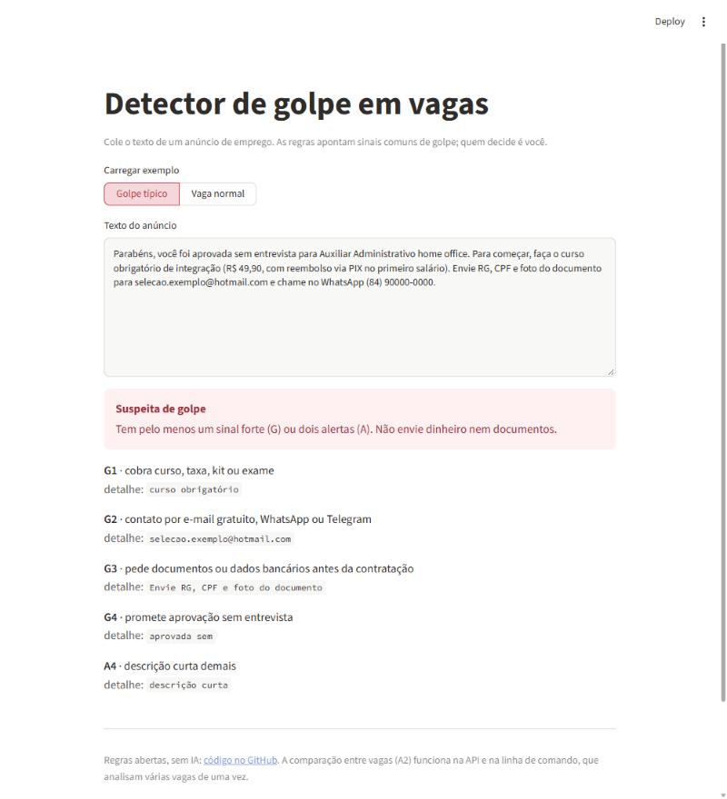

# Detector de golpe em vagas

> Rule-based scam detector for Brazilian job ads: Python library, CLI, FastAPI API and Streamlit page.

[](https://github.com/ibsondiniz/detector-golpe-vagas/actions/workflows/ci.yml)

Aponta sinais comuns de golpe em anúncios de emprego:
- cobrança de curso ou taxa;
- contato só por WhatsApp ou e-mail gratuito;
- pedido de documentos antes da contratação;
- promessa de aprovação sem entrevista;
- empresa que não se identifica;
- o mesmo texto publicado com cargos diferentes.

As regras vieram de uma ferramenta de busca de vagas que uso no dia a dia com amigos. Cada uma nasceu de um anúncio real que era golpe ou escondia a empresa. Os exemplos e testes deste repositório usam dados inventados.

**Teste no navegador:** https://detector-golpe-vagas.streamlit.app



## Sinais

| Código | O que indica |
|---|---|
| G1 | cobra curso, taxa, kit ou exame |
| G2 | contato por e-mail gratuito, WhatsApp ou Telegram |
| G3 | pede documentos ou dados bancários antes da contratação |
| G4 | promete aprovação sem entrevista |
| A1 | empresa confidencial com contratação urgente |
| A2 | texto igual ao de outra vaga com cargo diferente |
| A3 | salário alto para nível baixo (ensino médio, remoto, acima de R$ 3.000) |
| A4 | descrição curta demais |
| A5 | currículo por e-mail, WhatsApp, telefone ou link encurtado |
| A6 | modelo de anúncio não preenchido |
| C | empresa contratante não identificada |

**Veredito:**
- **CONFIDENCIAL** quando há sinal C: confirme a vaga no site oficial da empresa.
- **SUSPEITA** com qualquer sinal G ou com dois sinais A.
- **ALERTA** com um sinal A.
- **ok** quando nenhum sinal aparece.

As regras apontam, não decidem: a pessoa ainda lê o anúncio.

## Como rodar

Com [uv](https://docs.astral.sh/uv/):

```bash
uv sync
uv run detector-golpe exemplos/vagas.json        # linha de comando
uv run uvicorn detector_golpe.api:app --reload   # API em http://localhost:8000/docs
uv run streamlit run streamlit_app.py            # página em http://localhost:8501
```

Com Docker:

```bash
docker compose up --build
```

A API sobe na porta 8000 e a página na 8501.

### Exemplo de chamada à API

```bash
curl -X POST http://localhost:8000/analyze -H "Content-Type: application/json" \
  -d '{"jobs": [{"id": "1", "title": "Digitador", "text": "Aprovação imediata. Pague a taxa de cadastro e chame no WhatsApp."}]}'
```

A resposta traz o veredito e os sinais de cada vaga. Mande várias vagas na mesma chamada para que o sinal A2 compare os textos entre si.

## Testes

```bash
uv run pytest
uv run ruff check .
```

O GitHub Actions roda os dois e constrói a imagem Docker a cada push.

## Como funciona

[COMO_FUNCIONA.md](COMO_FUNCIONA.md) explica o fluxo, cada regra e as decisões de projeto.

## Limites

- Só português do Brasil.
- Regex erra: há falso positivo e falso negativo. Os testes guardam os casos já corrigidos.
- Sem IA de propósito. Regras são explicáveis, rápidas, grátis e funcionam sem internet.

## Autoria

Feito por Ibson Diniz com auxílio do Claude Code, a IA de programação da Anthropic. Eu trouxe os casos reais, defini as regras e revisei e testei o código.

Licença [MIT](LICENSE).
